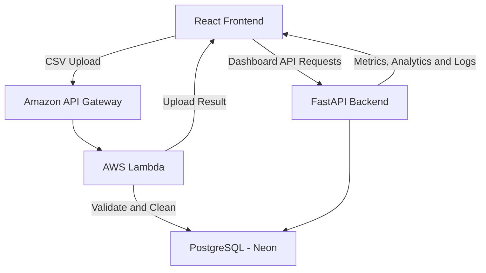

# SLA Monitoring Dashboard

A full-stack SLA Monitoring Dashboard that processes monitoring data from CSV files, validates and cleans records using an AWS Lambda serverless function, stores the results in PostgreSQL, and presents service-level metrics through an interactive dashboard.

## 1. Project Overview

The application helps monitor the health and performance of multiple services using monitoring-check records.

It provides:
- CSV upload and automated data processing.
- Data validation, cleaning, and duplicate detection.
- Serverless CSV processing using AWS Lambda.
- Persistent storage using PostgreSQL.
- Service availability and latency analytics.
- Filterable monitoring logs.
- Upload history and processing statistics.

## 2. Architecture



### Data Flow

1. The user uploads a CSV file through the React frontend.
2. The frontend sends the CSV content to Amazon API Gateway.
3. API Gateway invokes the AWS Lambda function.
4. Lambda validates, cleans, and processes the records.
5. Valid records, rejected records, and upload metadata are stored in PostgreSQL.
6. The frontend requests dashboard information from the FastAPI backend.
7. FastAPI queries PostgreSQL and returns dashboard metrics, analytics, logs, and upload history.

## 3. Technology Stack

| Component | Technology |
|---|---|
| Frontend | React, Vite |
| Styling | Tailwind CSS |
| Charts | Recharts |
| Icons | Lucide React |
| Backend API | Python, FastAPI |
| ORM | SQLAlchemy |
| Serverless Processing | AWS Lambda |
| API Gateway | Amazon API Gateway HTTP API |
| Database | PostgreSQL (Neon) |
| Lambda Database Driver | Psycopg 3 |
| Frontend Hosting | To be added |
| Backend Hosting | To be added |

## 4. Features

### CSV Upload and Processing
- Upload CSV files through the dashboard.
- Process files using AWS Lambda.
- Validate required fields and data types.
- Normalize timestamps to UTC.
- Convert latency values from seconds to milliseconds where applicable.
- Detect and remove duplicate observations.
- Track rejected records and data-quality issues.

### Dashboard Statistics
- Total monitoring checks.
- Total monitored services.
- Successful checks.
- Overall availability percentage.
- Average latency.
- Total uploads and rejected records.

### Service Analytics
- Availability comparison across services.
- Average latency comparison across services.
- Interactive charts with tooltips.

### Monitoring Logs
- Filter logs by date range.
- Filter by service.
- Filter by HTTP status code.
- Pagination for monitoring records.

### Upload History
- View previously uploaded CSV files.
- Check total, accepted, and rejected record counts.
- View upload processing status and upload date.

### Interactive Dashboard
- Collapsible dashboard sections.
- Automatic dashboard refresh after successful uploads.
- Responsive dashboard interface.

## 5. Data Cleaning and Processing

The project was tested using five monitoring datasets.

| Dataset | Raw Records | Cleaned Records |
|---|---:|---:|
| 9-day dataset | 4,672 | 4,664 |
| 12-day dataset | 6,230 | 6,219 |
| 14-day dataset | 7,269 | 7,256 |
| 21-day dataset | 10,904 | 10,885 |
| 30-day dataset | 15,577 | 15,551 |
| **Total** | **44,652** | **44,575** |

### Data Processing Findings

- 44,652 raw records were processed.
- 44,575 records were retained after cleaning.
- 72 duplicate observations were removed.
- 5 records with invalid HTTP status codes were rejected.
- 4,944 latency values were converted from seconds to milliseconds.
- 533 records had missing latency values.
- 5 records with negative latency values were retained with latency set to null and a quality flag.
- Unix timestamps and timestamps with explicit timezone offsets were normalized to UTC.

### Data Cleaning Assumptions

- A successful monitoring check is defined as an HTTP 2xx response.
- Duplicate observations are identified using service ID, normalized timestamp, agent, and region.
- Records from different agents at the same service and timestamp are not automatically treated as duplicates.
- Missing latency values do not cause otherwise valid records to be rejected.
- Negative latency values are treated as data-quality issues.
- HTTP status codes outside the range 100–599 are rejected.
- No arbitrary maximum-latency threshold is applied.

## 6. Database Design

The application uses PostgreSQL with four main tables.

| Table | Purpose |
|---|---|
| services | Stores monitored service information |
| upload_batches | Stores CSV upload metadata and processing counts |
| monitoring_checks | Stores validated monitoring observations |
| rejected_records | Stores rejected records and rejection reasons |

### Relationships

- Each monitoring check belongs to a service.
- Each monitoring check is associated with an upload batch.
- Each rejected record is associated with an upload batch.

## 7. API Endpoints

### FastAPI Backend

| Method | Endpoint | Description |
|---|---|---|
| GET | `/` | Backend root endpoint |
| GET | `/health` | Health check |
| GET | `/api/dashboard/summary` | Dashboard statistics |
| GET | `/api/dashboard/analytics` | Service-level analytics |
| GET | `/api/dashboard/logs` | Monitoring logs with filters and pagination |
| GET | `/api/dashboard/uploads` | Upload history |

### AWS Lambda Upload API

| Method | Endpoint | Description |
|---|---|---|
| POST | `/upload` | Upload and process a CSV file |

## 8. Project Structure

```text
EartRe_Case_Study/
│
├── backend/
│   ├── app/
│   │   ├── routes/
│   │   │   ├── analytics.py
│   │   │   ├── dashboard.py
│   │   │   ├── logs.py
│   │   │   └── uploads.py
│   │   ├── database.py
│   │   ├── models.py
│   │   ├── schemas.py
│   │   └── main.py
│   ├── requirements.txt
│   └── .env.example
│
├── frontend/
│   ├── src/
│   │   ├── components/
│   │   ├── App.jsx
│   │   └── main.jsx
│   ├── package.json
│   └── .env.example
│
├── lambda/
│   ├── csv_processor.py
│   ├── database.py
│   ├── db_writer.py
│   ├── lambda_function.py
│   └── requirements.txt
│
├── data/
│   └── cleaned CSV datasets
│
├── .gitignore
└── README.md
```

## 9. Local Setup

### Prerequisites

- Python 3.12 or compatible version.
- Node.js and npm.
- PostgreSQL database.
- AWS account for Lambda and API Gateway deployment.

### Backend Setup

Open a terminal:

```bash
cd backend
python -m venv .venv
```

Activate the virtual environment on Windows:

```powershell
.venv\Scripts\Activate.ps1
```

Install dependencies:

```bash
pip install -r requirements.txt
```

Create a `.env` file using `.env.example` and configure your PostgreSQL connection string.

Initialize the database and seed the services using the project's initialization scripts.

Start the backend:

```bash
uvicorn app.main:app --reload
```

Backend URL:

```text
http://127.0.0.1:8000
```

Interactive API documentation:

```text
http://127.0.0.1:8000/docs
```

### Frontend Setup

Open another terminal:

```bash
cd frontend
npm install
```

Create a `.env` file using `.env.example`.

Configure:

```env
VITE_API_URL=YOUR_LAMBDA_API_BASE_URL
VITE_BACKEND_URL=http://127.0.0.1:8000
```

Start the frontend:

```bash
npm run dev
```

The frontend will be available at:

```text
http://localhost:5173
```

### AWS Lambda Setup

The Lambda function uses Python 3.12 and Psycopg 3.

Install dependencies for the Lambda deployment package:

```powershell
cd lambda
python -m pip install --platform manylinux2014_x86_64 --target .\package --implementation cp --python-version 3.12 --abi cp312 --only-binary=:all: --upgrade -r .\requirements.txt
```

Package the Lambda source files and dependencies, excluding local environment files and test files.

Configure the Lambda environment variable:

```text
DATABASE_URL
```

Deploy the package to AWS Lambda and configure API Gateway to invoke the function through the `/upload` route.

**Important:** Never commit `.env` files, database credentials, or AWS secrets to GitHub.

## 10. Deployment

Deployment URLs will be added after hosting is completed.

| Component | URL |
|---|---|
| Live Dashboard | https://earthre-sla-monitoring-dashboard-fr.vercel.app/ |
| FastAPI Backend | https://sla-monitoring-backend.onrender.com |
| API Documentation | https://sla-monitoring-backend.onrender.com/docs |
| GitHub Repository | https://github.com/Het1124/EarthRe-SLA-Monitoring-Dashboard |
| AWS Lambda API | https://s9vfxqb606.execute-api.ap-southeast-2.amazonaws.com/prod |

## 11. Future Improvements

- Add authentication and role-based access control.
- Add configurable SLA thresholds.
- Introduce historical SLA trend analysis.
- Add alerting for service degradation.
- Improve analytics with additional performance indicators.
- Add automated testing and continuous deployment.

## 12. Author

Developed as an SLA Monitoring Dashboard case study project.

**GitHub:** [EarthRe-SLA-Monitoring-Dashboard](https://github.com/Het1124/EarthRe-SLA-Monitoring-Dashboard)
